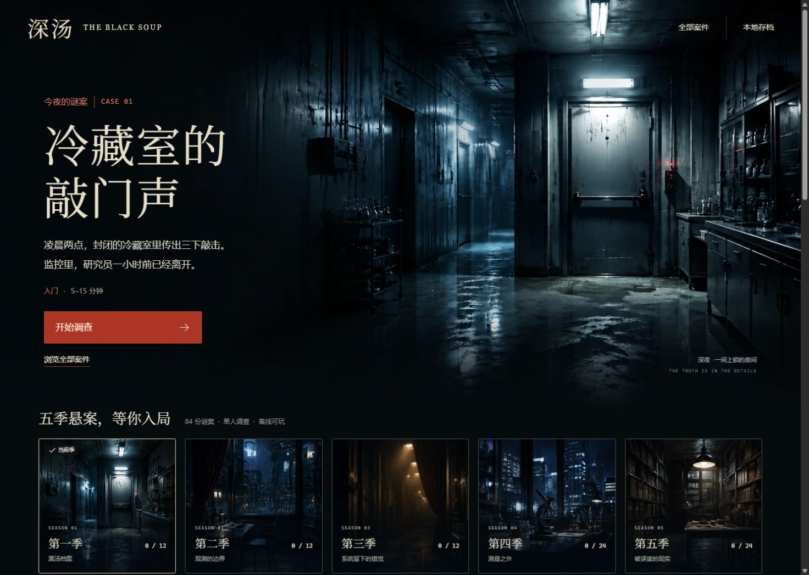

# THE BLACK SOUP · 深汤

> **你不只是猜中真相——你必须把它证明出来。**

中文、离线优先的单人海龟汤调查游戏。自由提问，检查证据，组织事件和关系，提交一份可验证的因果证明，再回看你是怎样结案的。

<p>
  
  
  
  
  
</p>

> [!IMPORTANT]
> 当前版本是 `v2.12-internal-rc`，状态为 `human-evaluation-pending`。工程自动化已覆盖核心、完整性、类型、冻结和静态构建；浏览器矩阵、当前版本离线恢复、视觉/无障碍、发行 ZIP 和真人 Fun Gate 仍未完成。84 个案件保持冻结，本版本没有新增案件。



## 先玩起来

需要 Git 和当前 LTS 版 Node.js。

```bash
git clone https://github.com/wangyufanshuai/turtle-soup.git
cd turtle-soup
npm ci
npm run dev
```

打开 <http://localhost:3000>。如果需要指定当前发行 profile：

```powershell
$env:TURTLE_SOUP_RELEASE_PROFILE="v2.12-internal-rc"
npm run dev
```

不要直接双击 HTML 文件；Web Worker 和 Service Worker 需要通过 HTTP 服务运行。

## 你会怎样调查

1. **现场**：阅读题面，观察地点、物件和异常。
2. **提问**：用自然中文提出可验证的问题。系统会展示理解的命题；有歧义时要求确认，无法安全理解时引导改写。
3. **证据**：检查公开材料，查看与问题相关的观察，再决定接入证明或暂时搁置。
4. **推断**：选择解释，组织事件链、关系和最小证据集。提交失败会指出证明缺口；成功后生成结案回放。

当前 Worker 已启用 M01 自然提问、M2 调查衔接和 M3 证明工作台。C01、C03、C61、C84 四个样板案已通过自动化完整配方，从首次进入走到正确结案、回放和四种挑战模式。

## 案件内容

共 84 案，分为五个赛季：

| 赛季 | 案件 | 重点 |
| --- | ---: | --- |
| Season 1 · 黑汤档案 | C01–C12 | 故事、时间与基础因果 |
| Season 2 · 系统现场 | C13–C24 | 物理约束、保管链与测量 |
| Season 3 · 身份流程 | C25–C36 | 身份、权限、影像与采样时间 |
| Season 4 · 科学复杂系统 | C37–C60 | 校准、信号、控制回路与网络拓扑 |
| Season 5 · 多感官档案 | C61–C84 | 材料守恒、视听路径、队列与反事实 |

建议先体验：

- **C01《冷藏室的敲门声》**：一声不应该出现的敲门。
- **C03《十二点的第二个影子》**：证言、服装与身份边界。
- **C61《少了一圈的胶带》**：计数如何与现场测量产生矛盾。
- **C84《停止以后仍完成的交接》**：两个章节、三块推理板的综合终案。

## 和普通海龟汤的区别

| 普通海龟汤 | 深汤 |
| --- | --- |
| 需要知道答案的主持人 | 单人游玩，确定性 Worker 代替主持人 |
| 主要猜出故事大意 | 必须提交可验证的完整证明 |
| 回答依赖主持人判断 | 固定 AnswerCode 和公开证据 |
| 主持人解释语言歧义 | 展示理解、确认候选或安全拒答 |
| 结束后读出标准答案 | 根据玩家调查生成回放 |
| 线下聚会为主 | 可离线、可存档、可撤销、可重玩 |

## 技术架构

```text
Next.js / React
├─ 首页与 InvestigationShell
│  └─ 只读取公共案件目录和 PlayerProjection
├─ Web Worker
│  └─ 懒加载完整 CaseFile，保存隐藏真相和胜负判断
├─ mystery-core
│  └─ 提问匹配、证据状态、证明结构、回放和存档重放
├─ IndexedDB
│  └─ 本地存档、精通记录和可清除的聚合诊断
├─ Service Worker
│  └─ 按 release profile 隔离离线缓存
└─ 可选 AI adapter
   └─ 只帮助排序公开问题候选，不接触真相，也不能改变胜负
```

核心安全边界：

- 完整 `CaseFile` 只存在于 Worker；
- React 只能收到不含隐藏事实和内部 ID 的玩家投影；
- 未知案件、跨案存档、哈希不匹配和伪造消息都会明确失败；
- AI 失败时回退到确定性流程；
- 存档和调查记录默认保存在本机。

## 当前验证状态

最新绑定构建：

- Profile：`v2.12-internal-rc`
- 案件：84
- 静态页面：90
- 离线缓存入口：1,374
- 核心测试：145/145
- 完整性回归：15/15
- 历史存档夹具：128/128
- 冻结基线：84 案、427 个文件、25 个历史 ZIP
- 四案完整 Worker 流程：C01、C03、C61、C84 全部通过

运行验证：

```bash
npm run baseline:v212 -- --check
npm run build:v212
npm run audit:v212:check -- core
npm run audit:v212:check -- integrity
npm run audit:v212:check -- typecheck-core
npm run audit:v212:check -- typecheck-web
npm run audit:v212:check -- frozen
npm run audit:v212:history
npm run audit:v212:static
npm run generate:v212:recipes
npm run verify:v212
```

`verify:v212` 采用失败关闭策略：没有证据的浏览器、离线、视觉、ZIP 或真人门禁会保持 `not-run`，不会被自动化结果推断为通过。

详细记录：

- [报告索引](./docs/report-index.md)
- [当前发行记录](./docs/v2.12-internal-rc.md)
- [发行验证 JSON](./docs/v2.12-release-verification.json)
- [浏览器矩阵](./docs/v2.12-browser-matrix.json)
- [静态性能报告](./docs/v2.12-static-performance.json)

## 开发约定

常用命令：

```bash
npm run check
npm run build
npm run build:v212
npm run test:m01
npm run test:m2
npm run verify:v212
```

案件内容是冻结资产。修改案件真相、证明向量、问题语义或公开文本时，必须同步更新版本化内容、存档回放和反泄漏测试；本轮工作不接受通过新增案件掩盖现有体验问题。

优先贡献方向：

- 中文自然问法覆盖和安全拒答；
- 首次进入、证据衔接和证明缺口反馈；
- 键盘操作、对比度和移动端布局；
- 浏览器流程、离线恢复和性能验证；
- 不泄露真相的案件质量工具。

## 项目状态

现在最需要验证的是：不知道答案的玩家能否自然地问出第一个问题，能否从答案进入证据，能否理解证明缺口，并愿意在结案后继续调查下一案。

在浏览器矩阵、离线恢复、视觉/无障碍、发行包和真人评估完成前，项目保持 `internal-rc`，不宣称正式发行或“已证明好玩”。

从一句不可能开始。用你的证据，让它变得必然。
