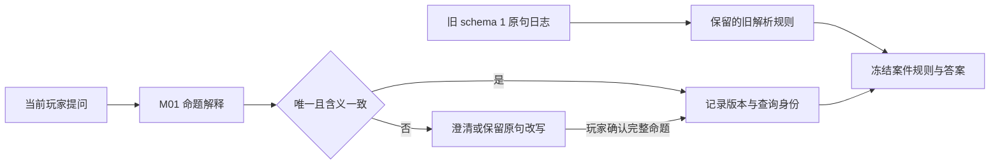

# M0/M1 实施与验证记录

本轮执行 `next-development-plan-2026-09-06.md` 中 TS-001～TS-006，范围是历史保护与 C01、C03、C61、C84 的语言/公开候选样板。由主代理完成，没有启动子代理。没有增加案件，没有外部部署、发布或生成新 ZIP，也没有把无人操作证据计作真人乐趣验证。

## 已实现

| 工作项 | 结果与证据 |
| --- | --- |
| TS-001 恢复点 | `E:/xuexi/turtle-soup-snapshots/m01-2026-09-06/`；25,550 文件，710,355,728 字节；复制前后逐文件 SHA-256 校验。完整清单位于该目录 `checkpoint-manifest.json`，摘要在 `output/m01/checkpoint.json`。保留了原有脏工作区；未替用户提交或清理既有修改。 |
| TS-002 F01 与关系近邻 | 先记录 3 项真实行为失败，见 `output/m01/red-routing.log`。新版把“敲门时冷藏室里有人吗？”绑定室内占用命题，不再绑定声音来源。前后时间、否定、复合句、人物/物品位置与来源近邻有回归。 |
| TS-003 重放身份 | 新提问写入 `ask_proposition`，包含原句、`resolverRevision: m01`、稳定查询 ID 和候选 ID；确认写入 `confirm_proposition`。运行时重新核对解释与绑定，拒绝伪造。旧 `ask_text` 保留原解析函数，旧确认保留原路径；外层仍是 schema 1，案件身份不变。旧 v2.11 校验器明确拒绝新命令，避免把未知字段丢掉后按旧规则误读。 |
| TS-004 否定/时间/复合 | 否定和反问先确认完整命题，不对答案码取反；复合问句只在玩家明确选择一句后计一次；未定义时间范围保持未识别。取消和改写会持久化清除待确认状态；新问题被拒绝时也不会留下旧确认。 |
| TS-005 首问出现条件 | 四案每案两条初始建议，明确标记 `starterEligible`；其余建议在相关事实/已检查材料出现后显示。C01 初始只建议占用与门锁，不推出设备或动机。此规则也用于问题改写候选和 AI 公开路由候选；无辅助模式保持关闭。其他 80 案未宣称完成编辑审查。 |
| TS-006 候选与语料 | 四案共 38 个查询有完整问题和来源 ID 映射，见 `output/m01/source-references.json`。独立保存 160 条留出输入，运行时不加载该文件；报告直接匹配、澄清、拒绝与分母。 |

新增开发配置是 `content/zh/releases/v2.12-m01-dev.json`。它显式继承 v2.12 的现有表现修订，并仅在该配置的 Worker 启用 M01 语言层。历史配置和未知未来配置没有自动启用新规则。原配置选择测试保留对全部历史配置的断言，并增加新配置与 v2.12 表现补丁完全相等的断言。

解析修订还未作为正式制品发布。后续若改变 `m01` 已接受命题的含义，必须增加修订并保留当前解码路径，不可直接重写历史规则。历史 AI 上下文保存在字节固定的 Worker 元数据中；兼容权限只用于存档重放，不作为实时请求的通行凭证。

## 内容边界

C01 的室内占用与声音来源使用不同命题，原 F01 日志仍按当时的声音来源查询重放；新问题才使用占用命题。事实、事件、解证和 canonical 身份没有改写。

C03 的“披风归谁所有”不能从“披风被借用”推出。新公开问题采用冻结内容支持的“穿披风的人就是罗弈吗？”，未记录的所有权问题不会被直接肯定/否定。玩家可以提出人物假设，但首问不会直接给出替补和灯光机制。

C61、C84 的多数冻结查询是 `verified_*`，事实只声明某项来源材料可复核，没有芯径、厚度、长度数值，也没有完整的控制时序公理。新候选明确询问“有记录可以核对……吗？”。这改善可理解性，但不构成真实测量或并发系统推理的内容重做。数量关系、先后和因果超出已定义命题时拒绝直接匹配，登记到 TS-015 的版本化内容修订。

## 实际检查

| 检查 | 实际结果 | 记录 |
| --- | --- | --- |
| 原有核心套件 | 145/145 通过 | `output/m01/core-tests-final.log` |
| M01 Worker 回归 | 9/9 通过 | `output/m01/routing-final.log` |
| 四案留出语料 | 160 条，无错误直接匹配；支持问法 62/64 被直接识别 | `output/m01/language-audit.json` |
| 旧运行时独立预期 | 128 有效夹具恢复成功，1 异常日志仍拒绝；覆盖 84 案，原夹具字节不变 | `output/m01/historical-replay.json` |
| 冻结保护 | 427 文件、84 案身份、25 个旧 ZIP 不变 | `output/m01/frozen-check.log` |
| 类型与静态构建 | 核心/网页类型检查通过；84 案构建成功；1,178 个预缓存项 | `output/m01/typecheck.log`、`build.log`、`precache.json` |
| 实际 UI | 内置 Browser；4 案 × 2 视口，共 8 组提问/恢复流程通过 | `output/m01/browser-final/` 与 `final-evidence.json` |

留出结果按案如下。精度分母只包括直接匹配，覆盖率分母是经来源审查的受支持问法；不能把拒绝所有输入算高精度成功。

| 案件 | 输入 | 受支持 | 正确直接匹配 | 错误直接匹配 | 澄清 | 未识别 | 支持问法覆盖率 |
| --- | ---: | ---: | ---: | ---: | ---: | ---: | ---: |
| C01 | 40 | 20 | 20 | 0 | 5 | 15 | 100% |
| C03 | 40 | 20 | 20 | 0 | 4 | 16 | 100% |
| C61 | 40 | 12 | 11 | 0 | 5 | 24 | 91.7% |
| C84 | 40 | 12 | 11 | 0 | 5 | 24 | 91.7% |

语料由主代理依据冻结来源编写，独立于既有生成模板和运行时规则文件；它不是外部作者或真人提供的语言样本。C61/C84 多条问法覆盖的是同一类“来源可核对”关系，不宣称 40 类不同推理能力。首轮报告另存 `language-audit-first-pass.json`；C03 的“后台”边界修复后同一语料复测，后者应视为回归结果，不能冒称新的盲测。两个未识别支持问法是“胶带圈数的材料能否复核？”和“停止命令的材料能否复核？”，保留到下一修订，不更改分母。

## Browser 操作与证据

最终构建在两个干净本地来源运行：桌面 `127.0.0.1:8102`（1440×900）、手机 `127.0.0.1:8103`（390×844）。不同来源用于避免先前构建的缓存/存档干扰，所有测试存档都由实际 UI 从新起点创建。没有通过网页存储、隐藏状态、Worker 注入或已解存档伪造流程。

每组执行：首问页面 → 输入受支持问法 → 否定句澄清且不计次 → 取消 → 页面重新加载仍无待确认 → 再次提问后改写并保留原句 → 明确确认规范命题（计次从 1 到 2）→ 撤销（回到 1）→ 页面重新加载仍为 1。每阶段保存公开 DOM 文本和视口尺寸，关键阶段截图；均未检测到横向溢出。C01 两视口另测时间变化、复合句和取消恢复；C61 数值外推、C84 控制关系外推另留桌面证据。

代表截图：

- `browser-final/c01-desktop-direct.png`：原 F01 已对应正确命题。
- `browser-final/c01-mobile-clarify.png`：原句、规范命题、否定解释、改写与取消。
- `browser-final/c03-desktop-clarify.png`：“后台”不再被识别为时间变化。
- `browser-final/c61-mobile-opening.png`：两条完整且基于谜面的首问。
- `browser-final/c84-mobile-restored.png`：确认、撤销后重载恢复。

初次构建的探索截图保存在 `output/m01/browser/`，只用于问题调查，不作为最终构建通过证据。浏览器探索曾发现 C03 “后台”被过宽时间规则拦截；已修复并补回归。自动操作还遇到一次过期 AX 编号和一次重载尚在加载页；刷新可访问树并等待输入框可见后重试，未将这些中间状态算作通过。

## 未执行与下一轮

本轮不是结案流程或发布验收。Firefox/WebKit、完整已知解法通关、ZIP 独立运行、实际手机键盘/设备、屏幕阅读器与完整无障碍审计、实时 AI 服务故障矩阵、真人乐趣均未执行。旧 v2.12 门禁报告没有用本轮提问流程替代或升级；现有 18 格完整通关矩阵继续保留原状态。

下一轮按以下顺序推进，不增加案件数量：

1. **TS-007、TS-008、TS-009（M2）**：改掉“解释 1/2/3”和无依据的“已选解释”；回答能定位到相关已公开材料；切换、改写、刷新保持同一原句与草稿。验收仍从四样板开始，不自动选 canonical。
2. **TS-010、TS-011、TS-012（M3）**：事件链与推理板共享有等价依据的编辑结果；组合操作先预检再保存；撤销后重新校验依赖；用实际错误解释检查缺口反馈和误胜。
3. **TS-015（M4 优先）**：为 C61/C84 单独起草版本化内容修订，补足真实测量条件与命令/接收/完成/审计区分。保留旧案、旧身份和旧存档，不在表现层虚构数值。其他样板通过后再审查余下 80 案。
4. **TS-018、TS-019、TS-020 与 TS-022**：扩大 AI/存档故障恢复、音频与可访问操作；最后在可执行环境完成跨引擎真实通关矩阵和独立制品验证。

复现本轮：设置 PowerShell 环境变量 `$env:TURTLE_SOUP_RELEASE_PROFILE='v2.12-m01-dev'`，依次运行 `npm run typecheck`、`npm run test:core`、`npm run test:m01`、`npm run build --workspace @turtle-soup/web`、`node --experimental-strip-types tools/prepare-static-release.ts . apps/web/out output/m01/precache.json`。历史复测脚本为 `output/m01/check-historical.mts`。最终源文件与构建摘要见 `output/m01/final-evidence.json`。
