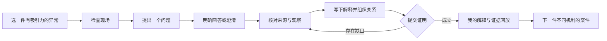

# 深汤：无真人参与阶段的 UI 与核心玩法开发计划

日期：2026-09-06。对象：现有 `E:\xuexi\turtle-soup` 项目。依据：任务“规划TURTLE SOUP推理游戏”的原始需求、关键迭代与创始人试玩反馈，当前源码、v2.12 交接和本轮内置浏览器实查。

本文是下一阶段的实施设计，尚未实现的事项均为计划。当前产品仍为 `internal-rc / human-evaluation-pending`。本轮使用 Browser 与 Game Studio 的架构、UI、试玩流程，未调用子代理。

## 1. 开发方向与决策

目标产品是一套**可以离线独立游玩的中文推理短篇集**：玩家从异常出发，自由提问，核对材料，提出自己的解释，通过可操作的证据关系证明它，最后看到自己的推理如何还原事件。

“顶级”落实为可检验的制作要求：主持人不答非所问；谜面与材料公平；操作表达推理；失败反馈可以继续推进；完成后有清楚的叙事回报；鼠标、键盘和手机都能顺畅操作。没有真人参与不阻止这些开发工作，但不能据此认定乐趣、理解率或留存已被验证。

本阶段采用以下明确决策：

- 保持 Web/PWA、中文、单人、离线优先。普通局作者目标约 5–20 分钟，复杂案可更长；这是设计意图，不是实测时长。
- 保留 Next.js / React DOM、CSS 与 SVG、Worker、TypeScript 确定性内核。文字调查工作台不需要迁移 Phaser、Three.js 或 Unity。
- AI 继续是默认关闭的可选语言助手；无 Key、断网、模型失败时核心玩法可完成。
- 先把 C01、C03、C61、C84 做成四个体验样板，再推广到 84 案。C03 是身份叙事样板，其冻结版本没有 `reasoningBoards`，不能凭空把它算作身份矩阵验收。
- 保留 84 案和历史身份，停止以增加案件数作为本阶段产出。暂缓账号、商城、多人、UGC 和随机生成案件。
- 每轮由主代理完成“设计—实现—浏览器检查—修正—记录”；默认零子代理。仅在有明确独立复核收益时，最多安排一名只读审查者。
- 开发期间使用同一条验收工具链与按运行分目录的证据，避免每个小版本再复制一套发行脚本。

最重要的体验依据来自已有创始人试跑：约 3 分钟理解提问循环、约 10 分钟形成解释，满足感主要来自自己总结真相；同时存在语言中断、操作不顺和不太想继续第二案。这是一位创始人的探索反馈，足以确定优先问题，不能外推到整体玩家。

## 2. 当前基线与本轮发现

本轮 `loadRun()` 校验通过，源码和构建仍匹配已有 v2.12 身份。`npm run test:core` 本轮重跑 **145/145 通过**。已有聚合报告为 **28 项：7 项通过、21 项未执行**。通过状态不等于每一项都在本轮重跑。

| 项目 | 当前证据 | 对后续的影响 |
| --- | --- | --- |
| 五季 84 案、25 个旧 ZIP | 交接与冻结记录；本轮身份一致 | 保留既有成果，修改须可追溯 |
| 历史存档 128 夹具、84 案原站不可用启动/恢复 | 已有绑定当前构建的记录；离线检查仅 IAB Chromium 390×844 | 可复用有效证据，不能扩大为三浏览器通关 |
| C01/C61/C84 完整 UI 流程 | 18 个引擎/视口组合仍为 `not-run` | 现有发行目标尚未完成 |
| AI 异常 UI、视觉/无障碍、独立 ZIP | 另外 3 项 `not-run` | 保留缺口，不创建提前通过的交付物 |
| 当前核心测试 | 本轮 145 项全部通过 | 基础可靠性有价值，语义覆盖仍需补充 |
| 正式真人参与 | 0；创始人探索会话 1 | 不把无人验收伪装为真人评测 |

本轮新增或重新确认的问题，按影响排序：

| 编号 | 现象与复现 | 判断 | 下一步 |
| --- | --- | --- | --- |
| F01 | C01 输入“敲门时冷藏室里有人吗？”后，直接记一次有效提问；系统理解显示“敲门声是人敲的吗？” | P1，已实测的命题错配。询问人员位置被换成声音施动者；当时回答是信息不足，不能据此声称答案码也已发生错误 | 加入语义对照回归，修正冲突识别与澄清规则 |
| F02 | C01 零提问进入推断，出现“待验证解释 1/2/3”，步骤提示“已选解释” | P1 体验问题。完整解释的提前曝光已被抑制，但目前选择没有可理解的含义 | 未有可读解释前不展示无意义选择；中性草稿不应算玩家已提出解释 |
| F03 | C01 零提问的首问建议含明确动机方向；C61 首问示例则为空 | 启发式剧透/引导风险，未证明一定破坏乐趣 | 为建议与提示建立逐案公开条件，不能只按数组顺序取前三项 |
| F04 | C61 改写工具仍有“卷盘芯径是否成立？”“剩余长度是否成立？”等 10 个名词式候选 | P1，已实测；首问过滤只是隐藏了不良文案，未修复候选本身 | 将候选改为有事实支持的可验证命题，无法支持的条目进入内容修订队列 |
| F05 | 回答下的“查看公开证据”只进入总证据架，没有定位到相关材料 | P2，源码与浏览器一致 | 返回当前已经公开的相关材料入口；确实没有对应材料则明确说明 |
| F06 | 推断仍区分推理板、事件链、证明篮；23 板型大多共用选片、填槽、连线 | 代码审查确认，实际冗余操作数待测 | 建立一次编辑、多种视图的证明工作台 |
| F07 | 统一 Shell 的当前音频控制缺少 AudioEngine 接线；旧 VariantShell 有相关实现 | 静态发现，尚非听觉测试结果 | 复用有效音频模块并实测，或移除不能兑现的控制 |

桌面档案风格、四工作区、手机底栏和醒目的事实回答已经具备基础，不必全面换皮。重点是信息层级、语义可信度和操作负担。原始截图、DOM、测试日志见[本轮审查证据](./next-development-evidence-2026-09-06.md)。

## 3. 玩家完整体验

### 开场：先想问什么

首页突出一个继续入口和一个推荐故事。卡片展示异常、题材、内容提示、作者难度/时长，不要求玩家先理解“聚合约束”“容量模型”等内部分类。五季仍可自由浏览，不通过锁关遮盖内容问题。

进入案件后，谜面、可检查对象和开始提问在首个可操作区域内建立关联。现场图支持气氛与对象定位；必要信息均有文字等价物。检查目标用可识别的物件或位置命名，避免把“材料推理”这样的类型当作地点。

第一案只解释当下需要的一个动作：先观察，再问一个命题。引导可以跳过；不会同时展开教程、全部建议、推理板和结案要求。以脚本记录“首次可操作”“首次核对材料”等时刻，只衡量操作路径，不冒充玩家理解速度。

### 调查：问题必须是玩家原本的问题

输入自然问题后，强匹配立即给答案；真正存在歧义时才请玩家确认。最新回答是视觉中心，原问题、系统理解、事实答案三者可对照。答案旁可撤销，并能打开有关的已公开材料。

信息不足应告诉玩家接下来如何寻找来源；它不等于“不是”。不能为了显得聪明而强行匹配，不能让 API 等待锁住输入和导航。系统能诚实地说明范围，也必须提供继续调查的方法。

### 推理：先形成解释，再组织证明

玩家的文字解释是表达与复盘工具，不被虚假地宣称为自然语言自动判卷。主解释与备选解释有独立草稿，证据可以支持或反驳某一关系。界面区分“我认为”“材料观察到”“已由提交验证”。

玩家整理事件后，在时间视图、关系视图看到的是同一份工作成果。必要的时间、因果、来源等不同义务仍需实际建立，不能因减少点击而自动补出正确关系。

### 结案：奖励自己的推理

结案先展示玩家自己的解释，然后按事件顺序回放已经证明的关系，并可回到所用材料。显示可追溯的调查记录，如某次提问或某件证据；除非玩家主动标注，不把模型猜测的“顿悟时刻”写成玩家真实经历。

完成页只突出“回顾我的证明”和“下一件案件”。限问、少证据、无辅助挑战作为二级入口；它们提供熟练度挑战，不把已知答案包装成新谜题。允许玩家在正常调查中随时退出并继续，不默认计时施压。

## 4. UI 的具体改造规范

| 界面 | 具体变更 | 完成标准 |
| --- | --- | --- |
| 首页 | 继续、推荐、当前季三层；推荐理由只用完成记录与公开题材/机制；完整目录保留 | 390×844 可见至少一个明确开始入口；无需设置 AI 即可进入 |
| 现场 | 谜面与可检查对象相邻；场景热点和文字列表指向同一对象；检查后反馈新材料并提供打开入口 | 任一必要线索都能通过文字/键盘取得；无纯看图找小点门槛 |
| 提问 | 一处输入、一组澄清、一个最新回答；历史问答收紧层级；全部候选按需展开 | 新问、改问、取消、重复、未识别、AI 失败各有可恢复状态 |
| 调查本 | 桌面辅助侧栏；手机抽屉；已读/已知/草稿区分 | 工作区切换不丢原句、草稿、阅读位置；不把 unknown 列为已确认事实 |
| 证据 | 来源、原始观察、玩家批注、关联解释分层；状态文案统一；支持相关材料定位 | 从回答到关联公开材料不超过两次明确操作；返回后保留问题上下文 |
| 推断 | 自己的解释、事件关系与提交检验围绕同一草稿；无意义编号暂不要求选择 | 玩家不需要为同一个事件重复录入；不会自动形成因果边或直接选择正确解释 |
| 失败反馈 | 在相关关系或材料处显示缺口类别与可执行动作 | 错误理论不会清空草稿；缺口反馈不输出未发现的正确事件、证据 ID 或完整答案 |
| 结案 | 我的解释 → 证明回放 → 下一案；过程数据折叠 | 每个回放断言均可追溯到当前案件证据；无虚构玩家行为 |
| 设置与恢复 | 体验、AI、存档分层；实际有效的音频控制；恢复前展示选项并保留原数据 | 关闭弹层焦点返回；失败不覆盖原存档；AI 未配置不成为流程障碍 |

视觉保持“暗色调查档案＋纸张材料”的方向：深炭色背景、暖灰正文、克制的案件强调色，事实回答使用纸张亮面；颜色之外同时使用文字和图标区分答案。中文正文建议 16–18px、常用控件标签至少 14px，阅读区约 28–36 个汉字宽度；辅助信息也要可读，不使用 7–9px 功能字号。

动作反馈采用约 120–180ms 的淡入/位移；重要状态改变才使用较明显动效。错误无需震屏，重复问答不制造失败惩罚。减少动态开启时移除非必要转场。主要触控区域以 44×44 CSS px 为项目目标；这不是所有 WCAG AA 控件的统一法定尺寸。[W3C 的 2.5.8 最小目标尺寸规则](https://www.w3.org/WAI/WCAG22/Understanding/target-size-minimum.html)为 24×24 CSS px，并有间距等例外。

响应布局先验证 1440×900 与 390×844，另做 360 宽、768 宽、200% 缩放压力检查。手机键盘出现时，输入框、验证按钮和底栏不能互相遮挡；模拟视口不算真实手机键盘/安全区验证。任何拖拽都提供点选和键盘等价操作，焦点可见，状态更新不要反复朗读整段历史。

## 5. 核心玩法与内核设计

### 5.1 语义路由：从“命中关键词”升级为“验证同一个命题”

F01 暴露的主要风险是：语句包含共同关键词，系统却忽略了关系差异。现有规则按优先级和词项得分取候选；具体失败的根因仍须用隔离回归确认，不能直接把修复简化为某个关键词补丁。

实施顺序：

1. 固定 F01 的原句、正确对照句、候选身份和公开结果。先有会失败的测试。
2. 将命题匹配涉及的主体、关系、时间限定、否定和复合句冲突显式纳入规则检查。精确命中经审核的同义句仍可快速回答。
3. “有人在里面”与“某人在敲门”必须可区分；时间从“之前”改到“之后”不得被礼貌语清洗抹掉。
4. 对否定反问，若不支持安全的极性解释，先显示规范命题请玩家确认；不能简单把答案码取反。
5. “A 并且 B 吗”不静默选其中一项。让玩家拆问或逐项确认，计次规则始终透明。
6. 低置信、互相冲突或超出案件范围的输入，进入明确澄清/无法判定路径，保留原句且不计有效提问。
7. 在保证直接回答准确率的前提下提高覆盖率；不能用“全部拒绝”获得漂亮的准确率。

建立逐案独立语料：正常同义句、关系近邻、否定、时间限定、指代、错字、复合问题、未记录细节、无关问题、要求泄底等。开发语料与留出语料分别保存；新失败样例进入回归后，同时补充未见过的留出样例。模板编号换词不能当作新的语义覆盖。

建议第一版量化门槛（是未来目标）：四样板每案至少 40 条有依据的留出输入；84 案每案至少 20 条风险覆盖输入。审核后的关键命题对照中错误直接回答为 0；完整留出集的直接匹配精度目标 ≥99%，同时报告覆盖率、澄清率、拒绝率、错误率及每案分母。经支持的明确同义句覆盖率目标 ≥90%；无法达到则保留问题列表，不以改分母达标。

### 5.2 解析修改必须与历史重放一起设计

旧 `ask_text` 可能只记录原句。改变解析规则后再重放原句，可能改变当年的含义、事实发现和后续结案。这是 P0 兼容风险，不能先改解析器、最后才补存档测试。

具体设计方向：保留旧 schema-one 信封读取与历史命令语义；新增确定性“已解析提问”命令或对现有已解析命令作兼容扩展，记录稳定查询身份、原句及解析修订。新会话使用显式解析结果；旧 raw-text 日志绑定冻结解析行为。AI 的临时 token/contextHash 继续在实时请求中严格校验，历史兼容仅在重放边界开放。

开始写代码前，用真实旧日志明确命令扩展方式与旧客户端行为，补上旧版本→新版的夹具。不为旧日志虚构缺失信息，原数据不可恢复时保留可导出的原件并说明原因。schema-one 外层保持兼容，不静默改 caseVersion、canonicalHash 或历史字节来掩盖问题。

### 5.3 信息披露：防泄底要覆盖整个界面

为每案展示内容声明出现条件：初始公开、检查后可见、相关事实确认后可见、结案后可见。应用于候选问题、首问建议、占位文字、事件标签、动机、推断标签、提示、回放与辅助技术文本。

首问建议仅基于谜面及已公开对象，默认不推出具体作案机制或动机。“全部 requiredFactIds 已获得”不应被当作普遍的故事节奏设计；不同案需要作者指定的公开条件。这些条件不修改冻结真相，且不能造成循环依赖或无法到达的必要事实。

未公开可理解假设时，UI 展示“我的暂定解释”和自由草稿，不展示待验证编号下拉框，也不宣称“已选解释”。待相关公共材料出现后才提供可比较的解释描述。提交所需的真实 hypothesis 选择仍由玩家完成，不能在后台替玩家挑出 canonical。

单独检查答案的位置线索：固定排序、默认选中、文案长度、唯一特殊图标都不应成为正确答案的暗号。离线资源在用户本机，Worker 隔离主要约束正常游玩与公开投影，不能承诺防止主动查看源码的人找到答案。

### 5.4 一份证明、多种视图

先建立玩家编辑状态与核心状态的映射表：事件、排序、关系、证据、动机、主/备选解释分别由谁拥有。界面位置与正在选中的起点属于临时 UI 状态；事实、事件关系和提交结果只由内核拥有。

事件链与推理板的同一事件共享选择/放置结果，使用有依据的显式 ID 映射；没有等价映射的结构继续独立，不能凭标题相似自动合并。时间先后和因果关系也不能互相代替。

组合编辑以“预检—应用—保存”形成原子操作：任一子步骤失败，不留下半套持久化状态。首先只为实际需要的两三种组合动作实现，不建设通用工作流引擎。撤销/恢复必须覆盖证据连接、事件移动和关系删除；撤销前置发现后，相关依赖重新校验，不能保留无依据的胜利状态。

提交反馈优先回答：当前解释有没有被公开证据反驳，哪个已知关系缺少支持，下一步可以核对哪类来源。区分“结构已填写”与“证明成立”，不显示未经内核证明的正确率百分比。

### 5.5 六种有区别的证明操作

保留 23 种内容板型，合并实现为六个交互家族。每个家族共用可访问控件与命令适配；显示操作只表达冻结内容真实支持的语义。

| 家族 | 玩家实际操作 | 首批验证对象 | 避免的伪交互 |
| --- | --- | --- | --- |
| 时间与区间 | 排事件、标时间来源、比较重叠 | C01 的传统事件链，C33/C84 的板 | 自动把排序变成因果；没有时间值却可任意拖数值刻度 |
| 身份与来源 | 将人物、外观、凭证、来源分列，再建立对应 | C20/C29；C03仅作身份叙事参照 | 一个格子的同色等于身份已证实 |
| 空间与路径 | 固定参照物、连接地点和路径、检查可见边界 | C24 | 无几何模型却声称模拟真实碰撞/遮挡 |
| 状态与因果 | 连接前态、触发、后态，展示各边证据 | C25/C84 | 默认给出正确连线；以动画代替规则 |
| 测量与守恒 | 区分读数、基准、对象/分量，组织约束 | C61 | 冻结内容没有数值，界面却虚构曲线计算 |
| 队列与替代解释 | 比较处理顺序；为备选解释附排除材料 | C72/C84 | 选择分支就自动揭晓正确解法 |

先实现时间/事件链与测量家族，验证共享证明编辑器，再做其余四族。所有控件要映射到现有可验证命令。若冻结内容不足以支撑新玩法，把它登记为版本化内容修订，保留旧案与旧存档，不借“表现层”名义偷偷改真相。

### 5.6 提示、内容与重玩

提示分为三层：检查方向、相关来源类别、某个已公开的证明缺口。由玩家主动展开；反复未识别时先提供语言帮助，不能自动泄露故事答案。提示记录与挑战限制一致。

为每案建立编辑卡：异常、初始误读、关键区分、事实命题、材料来源、合理错误解释、提示三级、结案回报、素材依据。所有重写注明原事实/查询/证据来源。未知细节不能由模型凭空补成“现场测得”。

内容推广以每批 12–16 案进行，先处理后期名词模板，再检查前期命题错配、题材术语和跨案残留。推荐路线按题材与机制交替编排，减轻连续重复操作。重玩只使用已有且被内核验证的挑战；新的证明多样性必须有合法证明集合，不能通过忽略必要条件制造多解。

## 6. 实施批次、依赖与交付

先设独立保存点保护当前未提交工作和有效证据，不硬重置、不覆盖旧发行物。记录 v2.12 未完成状态。产品开发与发行验证采用不同完成条件：已知问题可以继续修复；发行包必须等该构建的必需门禁真正通过。不会因为 Firefox/WebKit 暂不可用就停止所有 UI 开发，也不会把它们改记为通过。

以下是工作量估算，单位为单执行者专注工程日，含实现与一次完整反馈循环，不是对代理墙钟时间的承诺；每个批次完成后重估。

| 批次 | 重点任务 | 主要代码落点 | 依赖 | 可审查产物 / 退出条件 | 粗估 |
| --- | --- | --- | --- | --- | --- |
| M0 基线与已知缺陷 | 固定当前身份、保留脏工作树；为 F01 写失败回归；检查旧 raw-text 重放风险；在当前构建取得代表调查断点 | `engine.ts`、`runtime.ts`、`routing-replay-compat.test.ts`、`runtime-handler.ts` | 无 | 已知缺陷可重复复现；有清楚的修复与兼容方案；现有 21 项状态完整保留 | 1–2 日 |
| M1 可信提问 | 完成命题冲突处理、历史解析隔离；去除首问泄底方向；修正样板候选、精简确认流；AI 异常 fixture 联调 | `engine.ts`、`question-alias-pack.ts`、`use-question-router.ts`、`investigation-ui.ts`、展示覆盖层 | M0 | F01 不再答非所问；正确对照仍直接命中；旧日志等价；四案语言留出集达标 | 3–5 日 |
| M2 四案体验样板 | 首页/现场/问答/证据/推断/结案的连续体验；关联证据定位；可理解的解释选择；草稿与焦点恢复 | `case-select.tsx`、`investigation-shell.tsx`、`evidence-inspector.tsx`、对应 CSS | M1 | 四案桌面/手机完整已知解法流程；同一任务无重复输入、无丢草稿；前后截图和操作数 | 4–6 日 |
| M3 统一证明操作 | 事件共享、组合编辑与撤销；先做时间/测量，再扩展其余交互家族；缺口反馈 | `reasoning-board.tsx`、`legacy-theory-workbench.tsx`、`proof-readiness.ts`、Worker/运行时 | M2；只在需要处扩展命令 | 6 家族至少各有一案真 UI 通关；删证据/换关系等反例不能误胜 | 5–8 日 |
| M4 84 案精修 | 逐案命题、材料、提示、入口文案、回放校对；逐批推广样板；首玩路线调整 | `content/zh/presentation`、别名包、`golden-experience.ts`、逐案审查材料 | M2；具体板型依赖 M3 | 84 案每案有修订依据和检查结果；没有模板占位；内容不足明确列为修订案 | 6–10 日 |
| M5 可靠与沉浸 | 音频真实接线、焦点/键盘/缩放；按案缓存与完整下载；多标签冲突、保存失败、性能测量 | `audio-engine.ts`、`save-store.ts`、`archive-io.ts`、`pwa-registrar.tsx`、静态缓存工具 | M2；可按稳定组件穿插 | 实测与静态数值分开；恢复不丢档；控制有效；无操作遮挡 | 3–5 日 |
| M6 无人验收 RC | 同一最终构建的完整流程、全案核心、跨引擎、异常、离线、历史档、制品校验 | 复用 `v212-browser-contract.ts`、`v212-evidence.ts` 及发布工具思想 | M1–M5 | 所需门禁实测通过后生成独立 ZIP；公开状态仍标记真人评测待定 | 2–4 日 |

总量约 24–40 个专注工程日，M3/M4 内容不足可能扩大范围。不是要求一次自动任务无限运行；应拆成 1–2 个工作包一轮，每轮都交付可见变化或明确缺陷证据。

进入 M2 不要求先把旧构建的全部 18 格重复跑完；它要求 M0/M1 的开发退出条件满足。若产品改动进入新构建，旧 v2.12 继续保持未完成记录，不能借换版本删除既有义务。最终发布时对实际交付构建完整执行所需矩阵。

## 7. 可直接领取的开发工作包

P0 表示存档/胜负完整性风险，P1 表示核心调查受损，P2 表示明显体验缺陷。每轮至少有一个明确玩家可见结果，纯验证轮除外。

| ID | 优先级 | 工作包 | 验收重点 |
| --- | --- | --- | --- |
| TS-001 | P0 | 当前工作树、构建、旧包与收据保存点 | 可恢复；不重建冻结基线接受漂移 |
| TS-002 | P1 | F01 原句与关系近邻对照回归 | 原句匹配正确命题或澄清；不能转成声音施动者 |
| TS-003 | P0 | 新解析命令与旧 raw-text 重放隔离 | 旧日志公开状态/已解结果不被新规则改写 |
| TS-004 | P1 | 否定、时间与复合问句处理 | 极性/时间保持；不能静默丢掉半句 |
| TS-005 | P1 | 首问建议逐案出现条件 | 初始不暗示未发现的机制/动机；范围明确 |
| TS-006 | P1 | 四样板自然候选与留出语料 | 非模板、事实有出处、精度与覆盖率一起报告 |
| TS-007 | P1 | 移除无意义编号选择与虚假已选状态 | 保留玩家真实选择；不自动选择正确假设 |
| TS-008 | P2 | 回答到相关证据定位 | 两步内到达已公开材料；返回上下文保留 |
| TS-009 | P1 | 问答编辑、取消、切换、刷新连续性 | 输入/草稿/解释绑定正确，无陈旧确认覆盖新问题 |
| TS-010 | P1 | 一次组织事件，多视图表达 | 共享等价结构，时间和因果不被混为一项 |
| TS-011 | P0 | 组合编辑与依赖撤销 | 无部分保存、悬空关系、撤销后的虚假胜利 |
| TS-012 | P1 | 可理解的错误理论和缺口反馈 | 错误不清档、不惩罚探索、不泄底 |
| TS-013 | P2 | 时间/测量交互家族 | 全键盘与点击等价；操作确实改变证明状态 |
| TS-014 | P2 | 身份/来源、空间、状态、队列家族 | 各有独特任务表达与代表案验证 |
| TS-015 | P1 | C61–C84 优先公开语义修订 | 名词式候选清零，材料说明能独立读懂 |
| TS-016 | P1 | 其余 60 案逐批一致性与提示修订 | 逐案审查，不能以全库均分掩盖失败案件 |
| TS-017 | P2 | 结案回放与首玩路线 | 玩家解释突出；回放可追溯；推荐机制不连续重复 |
| TS-018 | P1 | AI 关闭、恶意、超时、CORS 等 UI 回退 | 不计次、不更改事实/证明、可以继续离线核心 |
| TS-019 | P1 | 保存失败/多标签/导入导出/版本迁移 | 原件保留，冲突可处理，84 案归档往返 |
| TS-020 | P2 | 真实音频、减少动态、对比和焦点 | 设置有效；无声音条件下信息完整 |
| TS-021 | P2 | 离线下载选择与实际性能预算 | 磁盘、传输、缓存、交互延迟分别实测 |
| TS-022 | P1 | 最终构建真实 UI 流程与跨引擎矩阵 | 不注入已解档；每一步有真实证据 |
| TS-023 | P1 | 全案错误解释/必要证据变异 | 错误不误胜，合法等价顺序不误拒 |
| TS-024 | P1 | 独立制品与交付说明 | ZIP 独立重验，旧包不变，未运行项不冒充完成 |

## 8. 无真人参与的验收方法

### A. 确定性核心：证明公平与一致

逐案验证 canonical、作者提供的错误假设、每个必要证据/事实缺失、关系与顺序变异、最小证据集合、主备选切换、重复命令、撤销依赖和保存恢复。顺序扰动只针对规则允许交换的独立动作，不能要求所有命令任意交换都等价。

状态轨迹测试使用固定随机种子、有限动作预算，报告探索状态/转移数量；不宣称穷尽无限状态空间。历史预期来自固定旧 runtime，不能由当前 runtime 同时生成 expected 与 actual。UI 的按钮断言不能替代真实 Worker 验证。

### B. 已知解法 UI：证明人通过界面可以完成

现有 v2.12 18 格继续按原契约：C01/C61/C84 × Chromium/Firefox/WebKit × 1440×900/390×844。每格包含新起点、开场观察、至少三句自然问题、歧义确认、刷新、检查证据、错误理论、证明缺口、组织、提交、回放、恢复。

样板阶段再加 C03 两视口，家族阶段增加 C20 或 C29、C24、C25、C72 等实际代表。最终矩阵由声明过的代表案集合生成精确分母；84 案×3 引擎×2 视口的路由/启动共 504 格，必须明确只是启动覆盖，不能写成 504 次通关。

操作者只能使用可见控件、AX/DOM、截图；结案配方只在已知解法流程使用，不读取网页隐藏状态，不注入存档或 Worker 命令。本轮仅使用用户指定的内置浏览器，不能把结果改称 Firefox/WebKit。其他引擎须在后续具备相应执行条件的独立测试环境实跑；未具备条件前保留 `not-run`。

### C. 公开信息合成探索：寻找发现困难

可用顺序运行的模型策略或有限脚本进行新手、探索型、字面理解型、反复改问型等探索，主代理负责检查结果，不需要为每个“人格”创建子代理。运行输入只含谜面、当时公开材料和规则说明；固定上下文与预算、记录模型/版本、运行序号和种子。

已经看过代码、配方或本计划案例事实的当前执行者不能称为盲玩。上下文被答案污染的运行只计入已知解法探索。可记录未识别链、反复切页、回退次数、卡点状态和预算耗尽，但这些都是合成行为指标，不能转化为真人满意度。没有适合的模型接口时，本项可保留未执行，继续做确定性和 UI 工作。

### D. 视觉、无障碍与性能：检查真实产物

固定代表状态截图，逐张判断层级、字号、对比、溢出、底栏遮挡、焦点与弹层。axe 严重问题目标为 0，同时做键盘通关、减少动态、200% 缩放；axe 通过不等于全部无障碍合规，真实辅助技术与手机没有运行须明确记录。

性能目标先锁测试条件：机器、引擎版本、视口、CPU/网络限制、冷/热缓存状态、样本量。常规确定性操作反馈内部目标 p95 ≤100ms，先有基线再判断；不混同于网站 INP。可参考 [Web Vitals](https://web.dev/articles/vitals)的良好阈值：LCP ≤2.5s、INP ≤200ms、CLS ≤0.1，且其真实用户评价看第 75 百分位。本项目无人阶段只能给实验室结果，不声称取得真实用户分位表现。

当前静态目录记录是 8,264,606 B，属于未压缩磁盘量。后续分别报告首页资源、首案额外资源、缓存后台下载、完整离线包，以及实际传输编码与请求字节。声音/美术加入前重新分配预算，不能沿用旧“首屏 JS”数字代表总下载。

### E. 发布证据：让通过状态可信

每份执行记录绑定 sourceTreeDigest、buildHash、profile、runId、实际引擎、视口、方法与原始证据。截图/DOM 的哈希只证明文件未改动，仍要有动作与观察内容。保留失败记录和修复后新收据。

代码、内容、工具或发行配置改变后，新构建不能继承旧 UI 成绩。开发内循环只重跑受影响检查；最终发行检查跑完整必需矩阵。旧源码测试、旧截图可以用作历史对照，不能伪装为新构建通过。

独立 ZIP 在非 ZIP 前置门禁通过后生成，再从该包独立服务检查资源、代表流程、缓存与文件哈希。跨引擎或必需流程缺失时保持未完成，既不降低门槛，也不把等待真人列为不能继续改进产品的理由。

## 9. 下一轮具体执行顺序

建议下一轮只领取 **TS-001～TS-006**，目标是“提问可信且可恢复”，完成后进入可理解推断与证据衔接。

1. 只读核对当前身份和未提交变更，建立可恢复保存点。保留现有冻结基线与收据。
2. 在本轮原句上建立红测试，补一组位置/施动者/时间/否定关系近邻，确定缺陷边界。
3. 先确定旧 raw-text 解析重放的隔离方式，用旧日志夹具证明兼容，再修改当前解析。
4. 复查公开建议和候选来源；修复 C01 首问提示时机与 C61 的可支持候选文案。其他两样板按同一标准处理。
5. 在 UI 中依次执行正确识别、冲突澄清、都不是/改写、确认、撤销、刷新恢复；记录原句与解释，没有人工输入要求。
6. 运行受影响测试、核心检查与类型检查，构建后用内置浏览器复测两种视口。未获得的引擎和完整流程证据保持未执行。
7. 交付修复差异、前后截图、留出语料结果、历史兼容记录和剩余缺陷；更新下一轮起点。

可直接用于下一轮的执行提示词：

> 在 E:\xuexi\turtle-soup 继续开发，先读 docs/next-development-plan-2026-09-06.md、docs/next-development-evidence-2026-09-06.md 与 docs/v2.12-next-step.md。执行 M0/M1 的 TS-001～TS-006，不扩展案件数量。默认由主代理完成，不启动子代理。
>
> 核心问题是 C01 自然问题“敲门时冷藏室里有人吗？”被静默理解为“敲门声是人敲的吗？”，同时样板案存在首问提示过早和名词式候选。先写失败回归及关系近邻测试，处理历史 ask_text 重放兼容，再修复路由与公开候选。保留冻结真相、canonical 身份、旧 schema-one 存档可读性和旧 ZIP。AI 只能辅助语言理解。
>
> 使用 Browser 内置浏览器操作实际 UI，按 Game Studio 的调查循环检查两种视口。验收正确命题识别或澄清、取消/改写、撤销、刷新和存档恢复。禁止注入已解档、读取隐藏状态冒充通关、搬用旧截图或放松已有门禁。保存真实证据。无人参与不阻止实现；真人乐趣仍保持待验证。
>
> 完成这个范围内必要的实现和验证后，给出代码变化、实际通过项、未执行项、截图路径和下一轮任务。发现相邻的阻断缺陷应修复；规模更大的内容或证明重设计记录到计划。无需在每个可逆本地步骤请求确认，不进行外部部署或未经本轮要求的发布。

这段提示词是接续执行材料；本轮没有自动创建 Goal、定时任务、提交或推送。

## 10. 本阶段完成的定义

产品层面：四个样板能代表完整的“观察—提问—证据—解释—证明—回放”体验；84 案公共文案与交互质量达到同一规范；六种证明操作有实际区别；已知高优先级缺陷关闭。

工程层面：旧存档与冻结内容受保护；同一交付构建经过必需 UI、离线、错误注入、无障碍和制品检查；报告可追溯；未运行项如实保留。

评价层面：可以称为“完成无人阶段制作与验证的候选版”，不能自动称为玩家已验证的顶级游戏。真人评测是未来衡量理解、惊喜、满足感和继续游玩意愿的独立阶段，不作为当前开发停工条件。

参考规范访问日期：2026-09-06。历史与本轮证据的边界见配套审查文档。

## 本轮执行记录（M0/M1）

TS-001～TS-006 已按四样板范围实施，详见 [M0/M1 实施与验证记录](m01-implementation-and-verification-2026-09-06.md)。完成 F01 命题修复、版本化提问与历史重放、否定/时间/复合处理、首问出现条件和 160 条语言语料验证；内置 Browser 已完成四案两视口的提问/恢复流程。此结果不替代本计划的完整通关、跨引擎、制品或真人评价门禁。下一轮从 TS-007～TS-009 开始，C61/C84 的内容不足随 TS-015 单独修订。

## 后续执行记录（M2）

TS-007～TS-009 已实施，详见 [M2 实施与验证记录](m2-implementation-and-verification-2026-09-06.md)。完成无默认选择的双解释草稿、基于公开材料的比较选项、主动选择/清空、两步从回答到相关材料，以及问题、阅读与草稿的恢复连续性。四样板两视口完成 8 条 M2 实际 UI 流程；145 核心、19 Worker、160 语言输入、128 有效历史存档与 1 负例、冻结保护均通过。未替代完整通关或发布门禁。**当前下一轮起点为 M3：TS-010～012**；具体分包与验收顺序见 M2 记录末尾。

## M3 长 Goal 完成后的起点

上段是 M2 完成时的历史起点。现已完成 M3 四轮实现，TS-010～012 的四案样板范围见 [M3 实施与验证记录](m3-implementation-and-verification-2026-09-06.md)。新增共享事件与独立板、原子操作、依赖撤销、旧结案归档、错误反馈与关系更换；最终 8 条两视口 UI 路径完成，C61/C84 可由实际控件从错误结构修正至提交和回放。正确结构参考作者规则，不代表独立解谜或真人乐趣验证。

**当前优先起点为 TS-015：C61/C84 公开材料与内容版本提案；随后 TS-013/014 的剩余家族、键盘等价与代表案实际验证。** 完整六家族目标尚未完成。TS-018/019 和旧发布门禁继续保留；不要用本轮部分矩阵替代它们。

## 2026-09-07 UI 打磨后的起点

已完成共享首页与调查界面的视觉整合、连续证据阅读、桌面/手机札记和推理板选卡流程；通过实际截图修正了浮层遮挡、低对比文字、阅读焦点跳转和极窄屏溢出。最终构建的四案两视口检查、C61/C84 错误修正与提交回放见 [UI 打磨与验证](ui-polish-2026-09-07.md)。该记录末尾列出下一轮四阶段执行顺序；首先解决 TS-015 的公开内容依据不足，再完善交互家族和其余案件，最后跑完整发行验收。

## 2026-09-07 TS-015 独立改写原型完成

本轮已将 C61/C84 的 25 份旧材料逐条映射为 12 份具有单位、时间、编号和边界条件的新材料，并提供独立可玩的材料检验原型。正确数值仍需来源支持，错误基准、顺序、停止范围与反事实会分别失败。11 项新增测试、145 项原有核心测试与两案实际 UI 检查通过。详见 [TS-015 改写提案与验证](ts015-content-revision-2026-09-07.md)。

**下一轮起点：版本化 CaseFile 集成。** 将两份提案的事实、自然问题、证明证书和回放按新语义建模，分配新内容版本与 canonical hash，保留旧案加载与存档；不可把原型通过状态迁成原案结案。完成后再进入 TS-013/014 的正式推理操作整合。无人阶段继续做材料充分性与反例审查，真人 Fun Gate 仍独立待验证。
